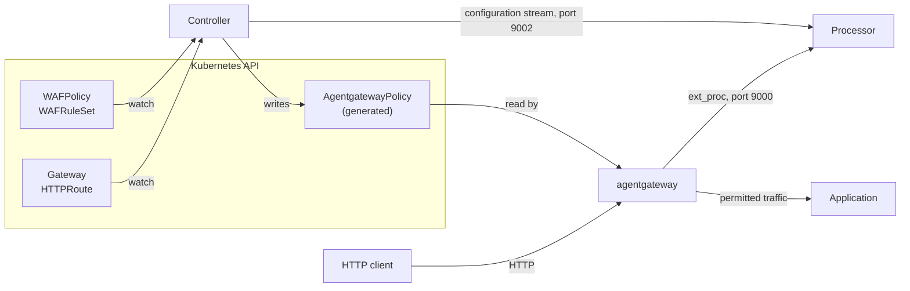

# Architecture

This document is a map of the gateway-protector code. It says what each
component does and where its code is. It does not describe the behavior in
detail.

[RFC 0001](rfc/0001-project-purpose.md) describes the purpose of the project,
the design, and the reasons for the design. The documents in the section
[Related documents](#related-documents) describe each part in detail.

## Components

gateway-protector adds a web application firewall (WAF) to the HTTP traffic
that flows through [agentgateway](https://agentgateway.dev). agentgateway is a
proxy that implements the Kubernetes Gateway API.

The project has two programs and two CRDs. A CRD (Custom Resource Definition)
adds a new object kind to the Kubernetes API.

| Component                         | Entry point              | Code                   | Ports                                                             |
| --------------------------------- | ------------------------ | ---------------------- | ----------------------------------------------------------------- |
| Controller                        | `cmd/controller/main.go` | `internal/controller/` | 9002 (configuration stream), 8081 (health probes), 8443 (metrics) |
| Processor                         | `cmd/processor/main.go`  | `internal/processor/`  | 9000 (ext_proc), 9001 (health probes)                             |
| CRDs `WAFPolicy` and `WAFRuleSet` |                          | `api/v1alpha1/`        |                                                                   |

The controller is the control plane. It reads the `WAFPolicy` and `WAFRuleSet`
objects, builds the configuration of the processor, and writes one
`AgentgatewayPolicy` object for each protected route.

The processor is the data plane. It receives the configuration from the
controller. It then inspects the traffic that agentgateway sends over
ext_proc, the external processing protocol of the Envoy proxy. The WAF engine
in the processor is [Coraza](https://coraza.io) with the OWASP Core Rule Set.

agentgateway is not a part of this project. It must be in the cluster before
you install the Helm chart.

## Two flows

The code follows two flows.

The configuration flow starts when a Kubernetes object changes:

1. The controller decides if each `WAFPolicy` is valid.
2. The controller builds one configuration from every valid policy.
3. The controller sends the configuration to each processor replica.
4. The controller writes the `AgentgatewayPolicy` objects and the status of
   each policy.

The request flow starts when a client sends a request:

1. agentgateway matches the request to an `HTTPRoute`.
2. If a generated `AgentgatewayPolicy` targets this route, agentgateway opens
   an ext_proc stream to the processor.
3. agentgateway sends the identity of the request: the gateway, the listener,
   the route, and the rule that it selected. The processor selects one Coraza
   engine by this identity.
4. The engine runs the rules, and the processor answers with a verdict.

## Where each task is in the code

Each path in this table is relative to the root of the repository.

| Task                                                             | Code                                                                                                    | Detailed document                                  |
| ---------------------------------------------------------------- | ------------------------------------------------------------------------------------------------------- | -------------------------------------------------- |
| Decide if a policy is valid, and write the `Accepted` condition  | `internal/controller/wafpolicy_controller.go`, `wafpolicy_conflicts.go`, `wafpolicy_target.go`          | [`wafpolicy-lifecycle.md`](wafpolicy-lifecycle.md) |
| Find the routes that a policy can apply to                       | `internal/controller/processorconfig/attachment.go`                                                     | [`policy-attachment.md`](policy-attachment.md)     |
| Find the policy of each request                                  | `internal/processor/config/snapshot.go`, `internal/processor/identity.go`                               | [`policy-attachment.md`](policy-attachment.md)     |
| Turn one policy into SecLang directives                          | `internal/controller/processorconfig/directives.go`                                                     | [`wafpolicy-lifecycle.md`](wafpolicy-lifecycle.md) |
| Build the configuration, and write the `Programmed` condition    | `internal/controller/processor_config_reconciler.go`, `internal/controller/processorconfig/build.go`    | [`wafpolicy-lifecycle.md`](wafpolicy-lifecycle.md) |
| Write the `AgentgatewayPolicy` objects                           | `internal/controller/processor_config_wiring.go`, `internal/agentgatewayapi/`                           | [`wafpolicy-lifecycle.md`](wafpolicy-lifecycle.md) |
| Send the configuration to the processor                          | `proto/configstream/v1/`, `internal/controller/configstream_server.go`, `processor_config_publisher.go` | [`processor.md`](processor.md)                     |
| Receive and compile the configuration                            | `internal/processor/config/`                                                                            | [`processor.md`](processor.md)                     |
| Inspect traffic over ext_proc                                    | `internal/processor/server.go`, `handlers.go`, `responses.go`                                           | [`processor.md`](processor.md)                     |
| Create and rotate the certificates for mutual TLS                | `internal/certs/`, `internal/controller/cert_reconciler.go`                                             |                                                    |
| Keep the memory of the controller cache low                      | `internal/controller/transform.go`                                                                      |                                                    |

## Repository layout

| Path                                            | Contents                                                                             |
| ----------------------------------------------- | ------------------------------------------------------------------------------------ |
| `cmd/`                                          | The entry points of the controller and of the processor.                             |
| `api/v1alpha1/`                                 | The Go types of the CRDs.                                                            |
| `internal/controller/`                          | The control loops, the server of the configuration stream, the certificate rotation. |
| `internal/controller/processorconfig/`          | The logic that turns policies into a configuration. It has no Kubernetes client.     |
| `internal/processor/`                           | The ext_proc server.                                                                 |
| `internal/processor/config/`                    | The configuration of the processor: parse, compile, resolve, and subscribe.          |
| `internal/certs/`                               | Certificate creation, and TLS credentials that reload without a restart.             |
| `internal/configstream/v1/`                     | Generated code for the configuration stream.                                         |
| `internal/agentgatewayapi/`                     | A copy of the `AgentgatewayPolicy` types that the controller needs.                  |
| `proto/configstream/v1/`                        | The protobuf definition of the configuration stream.                                 |
| `charts/gateway-protector/`                     | The Helm chart. It is the only deployment artifact.                                  |
| `examples/`                                     | Example `WAFPolicy` and `WAFRuleSet` manifests.                                      |
| `test/`                                         | The test suites that need a cluster or containers.                                   |
| `docs/`                                         | This document, the detailed documents, the RFCs, and the CRD reference.              |
| `Dockerfile.controller`, `Dockerfile.processor` | The production images.                                                               |
| `Tiltfile`                                      | The local development environment.                                                   |

## Tests

| Level          | Location               | Command                | What it covers                                                              |
| -------------- | ---------------------- | ---------------------- | --------------------------------------------------------------------------- |
| Unit           | `internal/`            | `make test`            | The logic of each package.                                                  |
| envtest        | `internal/controller/` | `make test`            | The control loops against a real Kubernetes API server.                     |
| End to end     | `test/e2e/`            | `make test-e2e`        | A Kind cluster with the Gateway API, agentgateway, and the Helm chart.      |
| Connector      | `test/coraza-e2e/`     | `make test-coraza-e2e` | The test suite of the Coraza connectors, through an agentgateway container. |
| CRS regression | `test/ftw/`            | `make test-ftw`        | The regression tests of the OWASP Core Rule Set, through agentgateway.      |
| Lint           |                        | `make lint`            | golangci-lint and `buf lint`.                                               |

[`CONTRIBUTING.md`](../CONTRIBUTING.md) describes how to run the tests, the
linter, and the Tilt environment.

## Related documents

- [`rfc/0001-project-purpose.md`](rfc/0001-project-purpose.md) describes the
  purpose of the project, the design, and the alternatives.
- [`processor.md`](processor.md) describes the configuration of the processor,
  the engine selection, and the flow of a request.
- [`wafpolicy-lifecycle.md`](wafpolicy-lifecycle.md) follows a `WAFPolicy`
  from its creation to its deletion.
- [`policy-attachment.md`](policy-attachment.md) describes how a policy
  selects traffic and how this selection reaches the processor.
- [`agentgateway-extproc.md`](agentgateway-extproc.md) holds the research
  notes on the ext_proc support of agentgateway.
- [`crds/`](crds/) holds the generated reference of the CRD fields.
