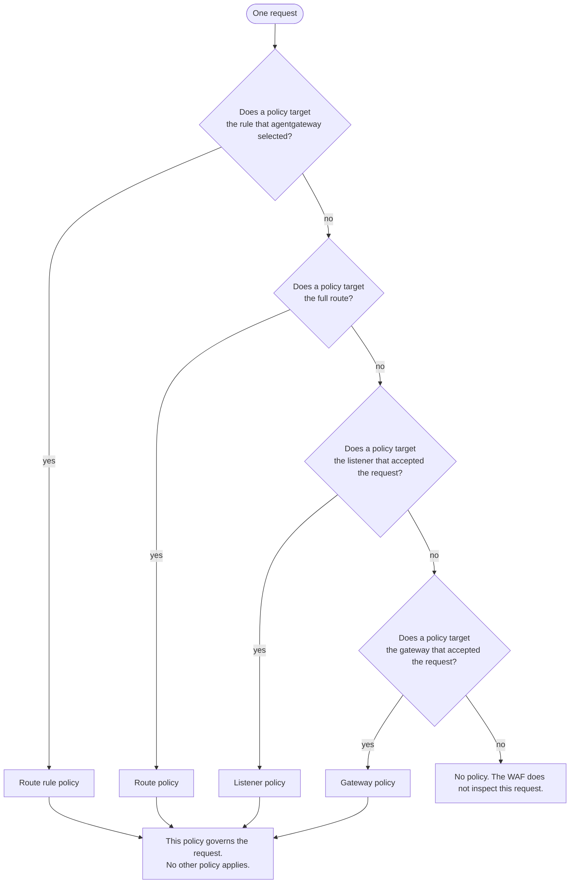
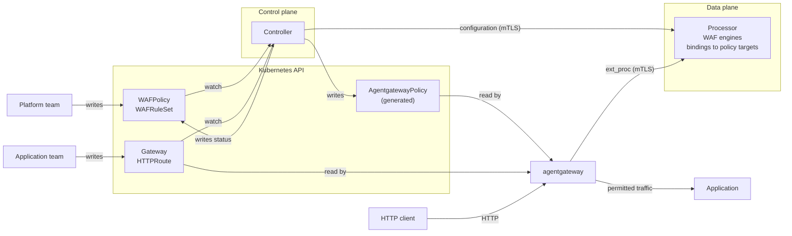
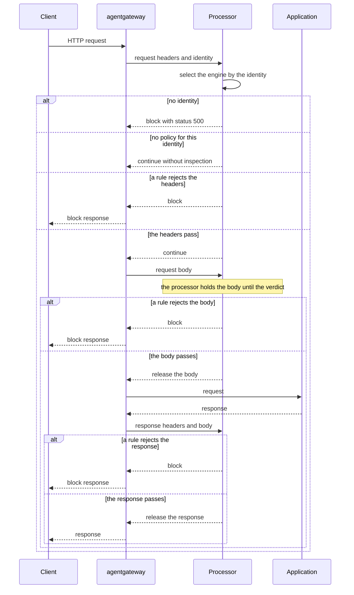

|              |                                 |
| :----------- | :------------------------------ |
| Feature Name | Project purpose                 |
| Start Date   | 2026-07-13                      |
| Category     | Project scope                   |
| RFC PR       | [fill this in after opening PR] |
| State        | **ACCEPTED**                    |

# Summary

[summary]: #summary

<!---
Brief (one-paragraph) explanation of the feature.
--->

gateway-protector protects the HTTP traffic that a gateway exposes from a
Kubernetes cluster. The gateway is a proxy that implements the
[Kubernetes Gateway API](https://gateway-api.sigs.k8s.io). The Gateway API is
the Kubernetes standard to route traffic with `Gateway` and `HTTPRoute`
objects.

The first protection is a web application firewall (WAF). A WAF inspects HTTP
requests and responses and blocks attacks such as SQL injection.

A platform team attaches a `WAFPolicy` object to a `Gateway` or to an
`HTTPRoute`. The platform team is the team that operates the gateways and owns
the security rules. gateway-protector then inspects the traffic of this target
with [Coraza](https://coraza.io) and the
[OWASP Core Rule Set](https://coreruleset.org) (CRS). Coraza is an open source
WAF library.

The CRS is a set of ready-to-use rules that find generic attacks. It is a
project of the OWASP Foundation. gateway-protector includes the CRS, so a
platform team does not have to write rules.

gateway-protector has two programs. The controller reads the `WAFPolicy`
objects and prepares the rules. The processor inspects the traffic with these
rules.

The project also plans a second protection, data loss prevention (DLP). DLP
finds sensitive data in a response and hides it before the response leaves the
cluster. The first version does not include DLP.

gateway-protector works with one gateway,
[agentgateway](https://agentgateway.dev). This choice is an implementation
detail. The user-facing API refers only to Gateway API objects.

This RFC states the purpose of the project, its scope, its components, its
API, and the decisions that shape its design.

# Motivation

[motivation]: #motivation

<!---
- Why are we doing this?
- What use cases does it support?
- What is the expected outcome?

Describe the problem you are trying to solve, and its constraints, without
coupling them too closely to the solution you have in mind. If this RFC is not
accepted, the motivation can be used to develop alternative solutions.
--->

A team that exposes HTTP applications through a gateway needs a way to protect
them against common web attacks. The Gateway API defines how to route traffic.
It has no object kind for a WAF.

To protect the traffic of a gateway, a team needs these parts:

- A WAF engine that inspects the traffic of the gateway
- A set of WAF rules, and a way to tune these rules for each application
- A way to select the routes that the WAF protects
- A process that updates all these parts when routes or rules change

This project supplies these parts. A team operates them with Kubernetes
objects.

The project has these goals:

- The platform team owns the protection. An application team cannot weaken it
  or disable it.
- One policy on a `Gateway` protects every route of this gateway. In this
  document, a policy is a `WAFPolicy` object.
- The number of protected applications has no fixed limit.
- Protection does not stop silently. If a protection component fails, the
  system blocks traffic. The name of this behavior is fail closed.
- The WAF and the planned DLP use the same model to select traffic.
- A policy targets only Gateway API objects. The platform team writes no
  object that is specific to one gateway product.

The expected outcome is a small amount of work for each team. The platform
team installs one Helm chart and writes one policy for each gateway.
Application teams change nothing.

## Examples / User Stories

[examples]: #examples

<!---
Examples of how the feature will be used. Interactions should show the action
and the response. When appropriate, provide user stories in the form of "As a
[role], I want [feature], so [that]."
--->

In this document, a false positive is a valid request that a rule rejects. The
project supports these user stories:

- As a platform engineer, I want to attach one policy to a `Gateway`, so that
  every route of this gateway gets the same protection.
- As a platform engineer, I want to attach a different policy to one
  `HTTPRoute`, so that a sensitive application gets stricter rules.
- As a platform engineer, I want to turn the WAF off for one route, so that a
  false positive never blocks a public status page.
- As a platform engineer, I want to run a policy in `Detection` mode, so that
  I can read the matched rules before I block traffic.
- As a platform engineer, I want to remove one CRS rule for one application,
  so that I can stop a known false positive.
- As a platform engineer, I want to write my own rules in a `WAFRuleSet`, so
  that many policies can use the same rules.
- As an application developer, I want to publish an `HTTPRoute` and nothing
  else, so that the platform protects my application for me.
- As an operator, I want a header on each blocked response, so that I can tell
  a WAF block from an application error.

The section [How a policy selects traffic](#how-a-policy-selects-traffic)
shows an example policy for the first three stories.

### A blocked request

A policy in `Blocking` mode protects an application. The gateway exposes this
application on the host `shop.example.com`. A normal request gets status
`200`:

```sh
curl -s https://shop.example.com/
```

A request with a script injection attack in the query string gets status
`403`:

```sh
curl -s "https://shop.example.com/?q=%3Cscript%3Ealert(1)%3C/script%3E"
```

The block response has an empty body and the header `x-waf-violation: 1`.

# Detailed design

[design]: #detailed-design

<!---
This is the bulk of the RFC. Explain the design in enough detail for somebody
familiar with the product to understand, and for somebody familiar with the
internals to implement.

This section should cover architecture aspects and the rationale behind
disruptive technical decisions (when applicable), as well as corner-cases and
warnings.
--->

This section gives the scope of the project and the design. The first
sections describe what a user sees: how a policy selects traffic, who owns
each object, and the API. The later sections describe how the project works:
its components, the objects that it generates, and the decisions behind the
design. Later documents will describe the implementation.

## Scope

The project does these things:

- It defines the `WAFPolicy` and `WAFRuleSet` kinds. These kinds are the
  user-facing API.
- It inspects requests and responses with Coraza and the CRS.
- It blocks the requests and the responses that the rules reject.
- It writes the `AgentgatewayPolicy` objects that send the traffic of each
  protected route to the WAF.
- It reports the state of each policy in the status conditions `Accepted` and
  `Programmed`.
- It protects its internal connections with mutual TLS (mTLS). With mTLS,
  each side of a connection presents a certificate.

The project does not do these things:

- It does not replace the gateway. agentgateway is a prerequisite.
- It does not support other implementations of the Gateway API, and it has no
  plan to support them.
- It does not change `Gateway` or `HTTPRoute` objects.
- It does not include DLP in the first version.
- It does not let you select the CRS version. Each processor image contains
  one CRS version.
- It does not support CRS plugins in the first version. A CRS plugin is an
  optional package of extra rules.
- It does not give a failure mode field. The project always fails closed.

## How a policy selects traffic

A policy has exactly one target. Four target shapes are possible:

| Target                     | Scope                                          |
| -------------------------- | ---------------------------------------------- |
| A `Gateway`                | Every request that this gateway accepts.       |
| A `Gateway` and a listener | Every request that this listener accepts.      |
| An `HTTPRoute`             | Every rule of this route.                      |
| An `HTTPRoute` and a rule  | This rule only.                                |

The most specific policy wins. It replaces every broader policy for the
traffic that it covers. The project never merges two policies, and it uses no
priorities. As a result, exactly one policy governs each request.

If no policy targets a `Gateway` or its routes, the WAF does not inspect the
traffic.

### The example scenario

The three cases that follow use one scenario. The `Gateway` `shared-gw` is in
the namespace `infra`. The routes `admin-portal` and `public-status-page` are
in the namespace `team-shop`, and they attach to this gateway.

```yaml
apiVersion: gateway.networking.k8s.io/v1
kind: Gateway
metadata:
  name: shared-gw
  namespace: infra
spec:
  gatewayClassName: agentgateway
  listeners:
    - name: http
      protocol: HTTP
      port: 80
      allowedRoutes:
        namespaces:
          from: All
---
apiVersion: gateway.networking.k8s.io/v1
kind: HTTPRoute
metadata:
  name: admin-portal
  namespace: team-shop
spec:
  parentRefs:
    - name: shared-gw
      namespace: infra
  hostnames:
    - shop.example.com
  rules:
    - name: admin
      matches:
        - path:
            type: PathPrefix
            value: /admin
      backendRefs:
        - name: admin-portal
          port: 8080
    - backendRefs:
        - name: shop
          port: 8080
```

The objects have these properties:

- The platform team owns the `Gateway`, and the application team owns the
  `HTTPRoute`. The `HTTPRoute` has no field for the WAF.
- The first rule of the route has the name `admin`. The second rule has no
  name.
- The route `public-status-page` has the same shape, so this document does not
  show it.

### A policy for one gateway

A policy targets the `Gateway`. It applies to every route of this gateway.
This is the common case.

```yaml
apiVersion: gateway-protector.kubewarden.io/v1alpha1
kind: WAFPolicy
metadata:
  name: shared-gw-default
  namespace: gateway-protector-system
spec:
  targetRef:
    group: gateway.networking.k8s.io
    kind: Gateway
    name: shared-gw
    namespace: infra
  engine:
    mode: Detection
  paranoiaLevel: 1
```

In `Detection` mode, the WAF logs each matched rule and blocks nothing.

### A different policy for one route

A second policy targets one `HTTPRoute`. The traffic that it covers uses only
the second policy. Every other route keeps the gateway policy.

```yaml
apiVersion: gateway-protector.kubewarden.io/v1alpha1
kind: WAFPolicy
metadata:
  name: admin-portal-strict
  namespace: gateway-protector-system
spec:
  targetRef:
    group: gateway.networking.k8s.io
    kind: HTTPRoute
    name: admin-portal
    namespace: team-shop
    sectionName: admin
  engine:
    mode: Blocking
  paranoiaLevel: 3
  anomalyThreshold:
    inbound: 5
    outbound: 4
```

This policy targets only the rule `admin` of the route `admin-portal`. The
value of `sectionName` is the name of this rule in the `HTTPRoute`. For this
rule, the policy replaces the gateway policy in full. Every other rule of the
route keeps the gateway policy. Without `sectionName`, the policy covers every
rule of the route.

### No WAF for one route

A policy with `mode: Off` targets one `HTTPRoute`. The WAF is off for this
route only.

```yaml
apiVersion: gateway-protector.kubewarden.io/v1alpha1
kind: WAFPolicy
metadata:
  name: public-status-page-off
  namespace: gateway-protector-system
spec:
  targetRef:
    group: gateway.networking.k8s.io
    kind: HTTPRoute
    name: public-status-page
    namespace: team-shop
  engine:
    mode: "Off"
```

Only the platform team can write this policy, so an application team cannot
turn the WAF off. The Ownership section gives the details.

### Selection order

agentgateway selects the route and the rule of each request with the full
rules of the Gateway API. It then tells the processor the gateway, the
listener, the route, and the rule of the request. The processor finds the
policy of the request in this order:



### Conflicts

A conflict occurs when two policies have the same target. In a conflict, the
oldest policy wins. The other policy gets the status `Accepted=False` with
reason `Conflicted`. A gateway policy together with a route policy is not a
conflict.

## Ownership

Kubernetes RBAC (role-based access control) keeps the protection in the hands
of the platform team.

| Persona          | Owns                                                                                            | Can change the protection                                  |
| ---------------- | ----------------------------------------------------------------------------------------------- | ---------------------------------------------------------- |
| Platform team    | The `WAFPolicy` and `WAFRuleSet` objects in one restricted namespace, and the `Gateway` objects | Yes                                                        |
| Application team | Its `HTTPRoute` objects in its own namespace                                                    | No. RBAC denies write access to the policy kinds.          |
| Controller       | The generated `AgentgatewayPolicy` objects and the configuration of the processor               | It is the only actor that reads the objects of both teams. |

A policy can target an object in another namespace. As a result, the platform
team can keep every policy in one namespace. An application team publishes its
routes, and the policies of the platform team protect them. An exception, such
as an exclusion for a false positive, is a decision of the platform team.

## API

The two kinds are in the API group `gateway-protector.kubewarden.io`, version
`v1alpha1`. The two kinds are namespaced.

### The Core Rule Set

The processor image contains one version of the
[CRS](https://coreruleset.org). Each policy with the mode `Blocking` or
`Detection` applies the CRS. Some fields of a `WAFPolicy` use terms of the
CRS:

| Term           | Meaning                                                                                                                                                                                |
| -------------- | -------------------------------------------------------------------------------------------------------------------------------------------------------------------------------------- |
| Anomaly score  | The CRS does not reject a request at the first rule that matches. Each rule that matches adds points to a score. The CRS rejects the request when the score reaches a limit.           |
| Paranoia level | A level from 1 to 4. A higher level turns on more rules. It finds more attacks, but it also gives more false positives.                                                                |
| CRS plugin     | An optional package of extra rules. The CRS project keeps the plugins outside the main rule set. For example, one plugin turns off the rules that give false positives with WordPress. |

The first version does not support CRS plugins.

### WAFPolicy

A `WAFPolicy` attaches one set of WAF rules to one target. This example uses
every field:

```yaml
apiVersion: gateway-protector.kubewarden.io/v1alpha1
kind: WAFPolicy
metadata:
  name: shop-strict
  namespace: gateway-protector-system
spec:
  targetRef:
    group: gateway.networking.k8s.io
    kind: HTTPRoute
    name: shop
    namespace: team-shop
    sectionName: admin
  engine:
    mode: Blocking
  paranoiaLevel: 3
  anomalyThreshold:
    inbound: 5
    outbound: 4
  requestBody:
    enabled: true
    maxSize: 1Mi
  responseBody:
    enabled: false
  exclusions:
    - byId: [942100, 949110]
    - byTag: ["attack-sqli"]
  customRulesRefs:
    - name: shop-custom-rules
status:
  conditions:
    - type: Accepted
      status: "True"
      reason: Accepted
    - type: Programmed
      status: "True"
      reason: Programmed
```

| Field in `spec`                                | Required | Meaning                                                                                            |
| ---------------------------------------------- | -------- | -------------------------------------------------------------------------------------------------- |
| `targetRef.group`, `kind`, `name`, `namespace` | yes      | The target. The kind is `Gateway` or `HTTPRoute`. The target can be in another namespace.          |
| `targetRef.sectionName`                        | no       | A listener name for a `Gateway`, or a rule name for an `HTTPRoute`.                                |
| `engine.mode`                                  | yes      | `Blocking` rejects the traffic that a rule matches. `Detection` only logs. `Off` disables the WAF. |
| `paranoiaLevel`                                | no       | The CRS paranoia level, 1 to 4. A higher level turns on more rules. The default is 1.              |
| `anomalyThreshold.inbound`, `outbound`         | no       | The CRS anomaly score limits for requests and for responses.                                       |
| `requestBody.enabled`, `responseBody.enabled`  | no       | They turn the inspection of bodies on or off. The default is on.                                   |
| `requestBody.maxSize`, `responseBody.maxSize`  | no       | The number of body bytes that the WAF holds for inspection, for example `1Mi`.                     |
| `exclusions[].byId`, `byTag`                   | no       | The CRS rules to remove, by rule ID or by tag.                                                     |
| `customRulesRefs[].name`                       | no       | The names of `WAFRuleSet` objects in the namespace of the policy.                                  |

### WAFRuleSet

A `WAFRuleSet` holds custom rules. The rules use SecLang, the rule language of
ModSecurity and Coraza. A policy in the same namespace references the
`WAFRuleSet` by name, so many policies can use the same rules.

A [directive](https://coraza.io/docs/seclang/directives/) is one statement in
SecLang. A rule is one kind of directive. The `SecRule` directive defines a
rule, which inspects one part of a request or of a response. Other directives
configure Coraza, for example the limit for the size of a body.

```yaml
apiVersion: gateway-protector.kubewarden.io/v1alpha1
kind: WAFRuleSet
metadata:
  name: shop-custom-rules
  namespace: gateway-protector-system
spec:
  rules:
    - id: 10010
      directive: |
        SecRule REQUEST_HEADERS:X-Internal-Health-Check "@streq 1" \
          "id:10010,phase:1,pass,nolog,ctl:ruleEngine=Off"
    - id: 10011
      directive: |
        SecRule ARGS:promo_code "!@rx ^[A-Z0-9]{6,12}$" \
          "id:10011,phase:2,deny,status:400,msg:'malformed promo code'"
```

The first rule turns the WAF off for a request with an internal health header.
The second rule rejects a request with a malformed `promo_code` argument.

The ID of a custom rule must be in the range 1 to 99999. This range prevents a
collision with the other sources of rules:

| Range                | Owner                                        |
| -------------------- | -------------------------------------------- |
| 1 to 99999           | Custom rules in `WAFRuleSet` objects.        |
| 900000 to 999999     | The rules of the CRS.                        |
| 9500000 to 9599999   | CRS plugins.                                 |
| 10000000 to 10000099 | Directives that gateway-protector generates. |

The rules in one `WAFRuleSet` keep their order. The order of the
`customRulesRefs` list has no effect. As a result, rules that depend on each
other must be in the same `WAFRuleSet`.

### Status conditions

Each policy reports two conditions, `Accepted` and `Programmed`. They follow
the convention of the Gateway API.

| Condition    | Status  | Reason           | Meaning                                                                                         |
| ------------ | ------- | ---------------- | ----------------------------------------------------------------------------------------------- |
| `Accepted`   | `True`  | `Accepted`       | The target exists, each `WAFRuleSet` reference exists, and no older policy has the same target. |
| `Accepted`   | `False` | `TargetNotFound` | The target does not exist, or the `sectionName` matches no listener or rule.                    |
| `Accepted`   | `False` | `Invalid`        | A `customRulesRefs` entry names a `WAFRuleSet` that does not exist.                             |
| `Accepted`   | `False` | `Conflicted`     | An older policy has the same target.                                                            |
| `Programmed` | `False` | `Pending`        | The policy is not accepted, or the controller did not process it yet.                           |
| `Programmed` | `True`  | `Programmed`     | The rules compiled, and they are in the configuration of the processor.                         |
| `Programmed` | `False` | `CompileFailed`  | The rules did not compile. The message holds the error.                                         |

### Changes to related objects

The controller examines a policy again when a related object changes. This
table shows the result of each change:

| Change                                                                           | Result                                                                                                                                          |
| -------------------------------------------------------------------------------- | ----------------------------------------------------------------------------------------------------------------------------------------------- |
| The target is deleted.                                                           | The policy stays in the cluster. It gets `Accepted=False` with reason `TargetNotFound`, and its rules leave the configuration of the processor. |
| The listener or the rule that `sectionName` names is removed or gets a new name. | The result is the same. The traffic then falls under the next broader policy, or under no policy.                                               |
| The target comes back.                                                           | The controller accepts the policy again. The platform team does not have to change the policy.                                                  |
| A referenced `WAFRuleSet` is deleted.                                            | The policy gets `Accepted=False` with reason `Invalid`, and its rules leave the configuration of the processor.                                 |
| A policy is deleted.                                                             | Its rules leave the configuration of the processor. If the policy won a conflict, the next oldest policy with the same target wins.             |

### DLPPolicy (not in the first version)

A `DLPPolicy` is the planned kind for DLP. It selects traffic in the same way
as a `WAFPolicy`. The example that follows is a sketch, and its fields can
change.

```yaml
apiVersion: gateway-protector.kubewarden.io/v1alpha1
kind: DLPPolicy
metadata:
  name: default-dlp
  namespace: gateway-protector-system
spec:
  targetRef:
    group: gateway.networking.k8s.io
    kind: Gateway
    name: shared-gw
    namespace: infra
  mode: Blocking
  inspect:
    requestBody: false
    responseBody: true
  detectors:
    - type: CreditCard
      action: Mask
    - type: USSSN
      action: Redact
    - type: Regex
      name: internal-token
      pattern: "ACME-[A-Z0-9]{20}"
      action: Block
```

Each detector finds one type of sensitive data. The action tells the processor
what to do with this data: `Block`, `Redact`, `Mask`, `Hash`, or `Alert`.

The project selects the WAF policy and the DLP policy of a route
independently. For example, a route can get its WAF policy from the gateway
and its DLP policy from the route.

## agentgateway

gateway-protector works with one gateway, agentgateway. Three properties of
agentgateway shape the design:

- agentgateway can send the traffic of a route to an external service for
  inspection. The protocol for this is ext_proc, the external processing
  protocol of the Envoy proxy. In this project, the external service is the
  processor.
- agentgateway has a `failureMode` field for ext_proc. The default value is
  `FailClosed`: when the external service is unreachable, agentgateway blocks
  the request. The other value is `FailOpen`.
- agentgateway has a `metadataContext` field for ext_proc. agentgateway
  evaluates the CEL expressions in this field for each request, and sends the
  results to the external service. The expressions can read the gateway, the
  listener, the route, and the rule that agentgateway selected.

Two components of the project are specific to agentgateway. The controller
writes `AgentgatewayPolicy` objects, and the processor handles some protocol
details of agentgateway. The `WAFPolicy` and `WAFRuleSet` kinds and the WAF
rules are not specific to agentgateway.

## Components

The project divides its work between a control plane and a data plane. The
control plane decides what the system must do. The data plane does this work
on the traffic. [Istio](https://istio.io) uses the same division. Its control
plane, istiod, sends configuration to the proxies of its data plane.

One difference exists. In Istio, the data plane is the proxy. In
gateway-protector, the proxy is agentgateway, and the processor is a service
that agentgateway calls.

The project ships three components:

| Component  | Responsibility                                                                                                                         |
| ---------- | -------------------------------------------------------------------------------------------------------------------------------------- |
| CRDs       | `WAFPolicy` and `WAFRuleSet` are the user-facing API. A CRD (Custom Resource Definition) adds a new object kind to the Kubernetes API. |
| Controller | The control plane. It reads the policies, builds the configuration of the processor, and writes the `AgentgatewayPolicy` objects.      |
| Processor  | The data plane. It receives the configuration and inspects the traffic that agentgateway sends over ext_proc.                          |

One Helm chart installs the three components. The Gateway API CRDs and
agentgateway must be in the cluster first.



### Controller

The controller does four tasks:

1. It decides if each policy is valid. A valid policy has a target that
   exists and `WAFRuleSet` references that exist. No older policy has the
   same target.
2. It builds the configuration of the processor from every valid policy.
3. It writes one `AgentgatewayPolicy` object for each protected route.
4. It writes the result in the status of each policy.

The controller does task 1 again when a related object changes. For example,
a user can delete the target of a policy. The section
[Changes to related objects](#changes-to-related-objects) describes each case.

In task 2, the controller also compiles the directives of each policy as a
test. As a result, directives that do not compile never reach the processor.

The controller can run more than one replica. Only one replica is active at a
time, and the other replicas wait.

### Processor

The processor is an
[ext_proc server](https://agentgateway.dev/docs/kubernetes/latest/documentation/traffic-management/extproc/).
agentgateway opens one ext_proc stream to the processor for each HTTP
exchange.

The processor holds two things in memory:

- It holds one WAF engine for each different block of directives. A WAF
  engine is one instance of the Coraza WAF. Coraza creates the engine when it
  compiles one block of directives.
- It holds one binding for each policy. A binding connects the target of the
  policy to one engine.

The processor has no dependency on the Kubernetes API, and it needs no
Kubernetes permissions. The processor image contains the CRS files. As a
result, the processor needs no network access to get the rules.

The processor can run more than one replica. Each replica gets the same
configuration.

### Configuration distribution

The controller sends the configuration to each processor replica over a
long-lived gRPC stream. The stream works as follows:

1. The processor connects to the controller and subscribes.
2. The controller sends the current configuration. It sends a new
   configuration after each change.
3. Each configuration carries a version. The version is a hash of the
   content.
4. The processor compiles the configuration. It then answers with the version
   and the result.

If a configuration is not valid, the processor rejects it and keeps the last
good configuration. If the stream fails, the processor connects again.

A replica without a configuration has no rules and cannot inspect a request.
It must not receive traffic. For this reason, the processor has a Kubernetes
readiness probe. A readiness probe tells Kubernetes if a pod can receive
traffic. The probe fails until the processor applies its first configuration.

agentgateway sends traffic only to the replicas that are ready. While one
replica is not ready, the ready replicas handle the traffic. If no replica is
ready, agentgateway cannot connect to the processor, and it blocks the traffic
of the protected routes.

As a result, a new processor replica needs the controller for its first
configuration. After that, the replica keeps the last good configuration, and
it stays ready when the controller is unreachable.

### Certificates

Two connections carry internal traffic. The first connection is the
configuration stream. The second connection is the ext_proc stream from
agentgateway to the processor. The two connections use mTLS.

The Helm chart creates one certificate authority (CA) and one certificate for
each side of each connection. The controller rotates the certificates before
they expire. Each side reads its certificate again for each new connection, so
a rotation needs no restart.

## Generated objects

The controller generates two things from the policies: the
`AgentgatewayPolicy` objects and the configuration of the processor. The
platform team does not write them.

### AgentgatewayPolicy

The controller writes one `AgentgatewayPolicy` for each protected `HTTPRoute`.
This object tells agentgateway to send the traffic of the route to the
processor. This example is the object for the route `shop`:

```yaml
apiVersion: agentgateway.dev/v1alpha1
kind: AgentgatewayPolicy
metadata:
  name: gateway-protector-shop
  namespace: team-shop
  labels:
    gateway-protector.kubewarden.io/managed: "true"
  ownerReferences:
    - apiVersion: gateway.networking.k8s.io/v1
      kind: HTTPRoute
      name: shop
      uid: 6a1f0c9e-3b7d-4e52-8a41-9d2c5f7b0e13
      controller: true
spec:
  targetRefs:
    - group: gateway.networking.k8s.io
      kind: HTTPRoute
      name: shop
  traffic:
    extProc:
      backendRef:
        kind: Service
        name: gateway-protector-processor
        namespace: gateway-protector-system
        port: 9000
      processingOptions:
        requestHeaderMode: Send
        responseHeaderMode: Send
        requestBodyMode: FullDuplexStreamed
        responseBodyMode: None
        requestTrailerMode: Skip
        responseTrailerMode: Skip
      metadataContext:
        gateway-protector.kubewarden.io:
          gatewayNamespace: proxy.gateway.namespace
          gatewayName: proxy.gateway.name
          listenerName: proxy.listener.name
          routeKind: default(proxy.route.kind, "")
          routeNamespace: proxy.route.namespace
          routeName: proxy.route.name
          routeRule: default(proxy.route.rule, "")
```

The object has these properties:

- The object is in the namespace of the route, and the route owns it.
  Kubernetes deletes the object together with the route.
- The label identifies the objects that the controller generates. If a user
  changes or deletes one of them, the controller writes it again.
- The body modes come from the policies of the route. If no policy inspects a
  body, the mode is `None`, and agentgateway does not send this body.
- A route with a `mode: Off` policy also gets this object. The processor then
  applies an engine that has the rules off.
- The `metadataContext` field holds CEL expressions. CEL is the Common
  Expression Language. agentgateway evaluates the expressions for each
  request, after it selects the route. It sends the results to the processor.
  The results are the identity of the request: the gateway, the listener, the
  route, and the rule.
- The expressions read only the `proxy` variables. agentgateway sets these
  variables from its own route selection, so a client cannot change them.
- The `metadataContext` field is the same for each route. A change to a
  policy does not change this object.

### Configuration of the processor

The controller turns each valid policy into one block of directives. The
configuration has three parts:

- The `schemaVersion` part gives the version of the format. The processor
  rejects a configuration with another version.
- The `directives` part maps an engine key to a block of directives. The
  processor compiles each block into one Coraza engine instance.
- The `bindings` part has one binding for each valid policy. A binding gives
  the target of the policy and an engine key.

An engine key is the name of one Coraza engine in the configuration. The
controller computes the key from the block of directives of the engine. The
key is the first 16 characters of the SHA-256 hash of the block. A hash is a
short value that a function computes from data, and the same data always gives
the same hash.

The engine key has two purposes:

- It connects each binding to one block of directives.
- It lets two policies with the same directives share one engine. The design
  decision
  [Policies with the same directives share one engine](#policies-with-the-same-directives-share-one-engine)
  gives the details.

The controller sends the configuration as JSON. This example uses YAML and
shortens the directives:

```yaml
schemaVersion: 2
directives:
  9f2b6c0e4a1d7c35: |
    Include @coraza.conf-recommended
    SecRuleEngine On
    Include @crs-setup.conf.example
    Include @owasp_crs/*.conf
  0d4e8a7b3c2f1e69: |
    SecRuleEngine Off
bindings:
  - kind: Gateway
    namespace: infra
    name: shared-gw
    waf:
      engineKey: 9f2b6c0e4a1d7c35
  - kind: HTTPRoute
    namespace: team-shop
    name: shop
    sectionName: health
    waf:
      engineKey: 0d4e8a7b3c2f1e69
```

In the example, `9f2b6c0e4a1d7c35` is the engine key of the engine with the
CRS, and `0d4e8a7b3c2f1e69` is the engine key of the engine that has the rules
off. The two values are invented.

The directives in the example have these effects:

| Directive                          | Effect                                                                           |
| ---------------------------------- | -------------------------------------------------------------------------------- |
| `Include @coraza.conf-recommended` | It loads the base directives that Coraza recommends.                             |
| `SecRuleEngine On`                 | It turns the rules on. `DetectionOnly` only logs, and `Off` turns the rules off. |
| `Include @crs-setup.conf.example`  | It loads the setup of the CRS.                                                   |
| `Include @owasp_crs/*.conf`        | It loads the rules of the CRS.                                                   |

The files with the `@` prefix are inside the processor container image.

The processor uses the identity of each request to find a binding, in the
order of the section [Selection order](#selection-order). In the example,
agentgateway sends a request for `/health/live` to the rule `health` of the
route `shop`, so the processor uses the engine that has the rules off. Every
other request that the gateway `shared-gw` accepts uses the engine with the
CRS. A request for `/healthz-admin` also uses the engine with the CRS,
because agentgateway sends it to another rule.

The configuration has no hosts and no paths. As a result, a change to an
`HTTPRoute` does not change the configuration.

The controller writes the directives of one engine in this order:

1. The base directives that Coraza recommends
2. The engine mode
3. The limits for the inspection of bodies
4. The paranoia level and the anomaly score limits
5. The CRS rules
6. The custom rules of each referenced `WAFRuleSet`
7. The exclusions

## Request path

A protected request follows these steps:

1. The client sends a request to agentgateway.
2. agentgateway matches the request to an `HTTPRoute`.
3. If a generated `AgentgatewayPolicy` targets this route, agentgateway opens
   an ext_proc stream to the processor.
4. agentgateway sends the identity of the request: the gateway, the listener,
   the route, and the rule. The processor selects one WAF engine by this
   identity.
5. The engine runs the rules on the request. If the policy inspects request
   bodies, the processor holds the body until the verdict.
6. If a rule rejects the request, agentgateway returns a block response to the
   client. The request never reaches the application.
7. If no rule rejects the request, agentgateway forwards it to the
   application. The processor then inspects the response in the same way.



The processor inspects one HTTP exchange in four phases:

| Phase            | What the processor does                                                                                                                     |
| ---------------- | ------------------------------------------------------------------------------------------------------------------------------------------- |
| Request headers  | It selects the engine and runs the rules on the URL and the headers. A request with no body gets its full verdict in this phase.            |
| Request body     | It holds the body until the verdict. A blocked body never reaches the application. The field `maxSize` limits the memory for the held body. |
| Response headers | It runs the rules on the headers. If the policy inspects response bodies, it holds its answer until the verdict on the body.                |
| Response body    | It holds the body until the verdict. A block in this phase replaces the full response.                                                      |

A block response has status `403` by default, an empty body, and the header
`x-waf-violation: 1`. A rule can set a different status. The processor writes
the rule ID to its log but never sends it to the client. A rule ID in the
response helps an attacker probe the rules.

The processor writes one log line for each rule that matches. The line holds
the rule ID and the severity. In `Detection` mode, these lines are the only
result of a match.

## Deployment

The processor runs as its own Deployment with a Service. Each generated
`AgentgatewayPolicy` points to this Service. As a result, the processor scales
independently of agentgateway, and a small number of pods share the memory of
the engines.

The CRDs and the controller do not depend on this layout. The Alternatives
section describes a second layout, the sidecar.

## Design decisions

### The gateway selects the route, the processor selects the rules

agentgateway decides whether a request goes to the processor. The processor
decides which rules apply to the request. For the first decision, the
controller writes one `AgentgatewayPolicy` for each protected route. For the
second decision, agentgateway tells the processor the route and the rule
that it selected, and the processor finds the policy of this route and rule.

Only agentgateway matches requests to routes. The processor does not repeat
this work with a smaller set of rules, so the two cannot disagree. Other WAF
integrations work the same way: the proxy selects the configuration with its
own router, and the WAF receives the result. The bindings in the processor
have no fixed limit on the number of applications.

### Policies with the same directives share one engine

The controller writes the directives of each policy in a fixed order. It then
computes the engine key from these directives. Two policies with the same
meaning get the same engine key. As a result, the processor compiles and holds
one engine for the two policies.

### One processor for the WAF and for DLP

One ext_proc stream carries the request and the response of one HTTP exchange.
As a result, one process can run the WAF and, later, DLP with one network hop.
The cost is that the two protections share one failure domain. The design
gives each protection its own CRD, so a later version can divide the backends
without an API change.

### Fail closed at each layer

Protection does not stop silently at any layer:

- When no processor replica is reachable, agentgateway blocks the traffic of
  the protected routes. The generated `AgentgatewayPolicy` keeps the default
  failure mode, `FailClosed`.
- When a Coraza engine returns an error, the processor answers with status
  `500`.
- When a request reaches the processor without its identity, the processor
  answers with status `500`. The processor cannot find the policy of the
  request.
- A replica without a configuration receives no traffic, because its readiness
  probe fails.
- When a new configuration is not valid, the processor keeps the last good
  configuration.
- A conflict between two policies has one defined winner.

### The controller rebuilds the configuration each time

The controller rebuilds the full configuration from the current cluster state
on each change. It does not patch the configuration in steps. As a result, the
configuration depends only on the objects in the cluster, and a deleted policy
needs no cleanup step.

### No dependency on cert-manager

The Helm chart creates the certificates for mTLS at install time. The
controller then rotates them. This is the same approach as the Kubewarden
admission controller.

## Corner cases and warnings

- If the rules of a policy do not compile, the policy gets the status
  `Programmed=False` with reason `CompileFailed`. The unresolved questions
  cover the traffic of its routes.
- An `HTTPRoute` can attach to more than one `Gateway`. In this case, each
  request gets the policy of the gateway that accepted it.
- A listener policy applies to each request that the listener accepts. The
  `parentRef` of the route does not have to name the listener.
- A user-written `AgentgatewayPolicy` that sends traffic to the processor
  without the `metadataContext` field gets status `500` for each request.
- After an upgrade from the version that selected engines by host and path,
  some requests can get status `500`. This happens until agentgateway reads
  the generated objects that the new controller writes again.
- The generated `AgentgatewayPolicy` targets the full route. If a policy
  covers only one rule, the traffic of the other rules goes through the
  processor without inspection.
- The processor Service must not set `publishNotReadyAddresses`. With this
  field, agentgateway also sends traffic to a replica that is not ready, and a
  replica without a configuration lets traffic through without inspection.

# Drawbacks

[drawbacks]: #drawbacks

<!---
Why should we **not** do this?

  * obscure corner cases
  * will it impact performance?
  * what other parts of the product will be affected?
  * will the solution be hard to maintain in the future?
--->

- Each protected request adds calls from agentgateway to the processor. These
  calls add latency. We do not know this cost yet.
- The project always fails closed and gives no way to fail open. As a result,
  an outage of the processor stops every protected application.
- A new processor replica cannot start to serve when the controller is
  unreachable. It needs the controller for its first configuration.
- The project works only with agentgateway. A team with another
  implementation of the Gateway API cannot use it.
- The controller depends on the API of agentgateway. We must follow its
  changes.
- An application team cannot correct a false positive itself. It must ask the
  platform team for an exclusion.
- A route policy replaces the gateway policy in full. As a result, a route
  policy must repeat each gateway value that it wants to keep.
- A policy can target one rule of an `HTTPRoute` by the name of the rule. The
  application team owns the route and can change this name. The traffic of
  the rule then falls under the next broader policy, and this policy can be
  weaker. The policy for the rule reports `TargetNotFound`, so the platform
  team can find the change.
- The WAF and the planned DLP share one process, so a failure stops the two
  protections together.

# Alternatives

[alternatives]: #alternatives

<!---
- What other designs/options have been considered?
- What is the impact of not doing this?
--->

This section describes the designs that we considered and dropped. If we do
not do this project, a team that wants Coraza and the CRS on its gateway must
build and operate these parts itself.

## Select the engine by host and path in the processor

In this design, the controller builds a table of hosts and path prefixes from
the `HTTPRoute` objects. The processor then selects the engine with the host
and the path of each request. The first version of the project used this
design.

We dropped this design because the processor repeats the route selection of
agentgateway with a smaller set of rules:

- A path prefix in the table is a plain string prefix. A Gateway API
  `PathPrefix` matches full path segments only.
- The table ignores the header, query parameter, and method matches of a
  rule.
- The table has no gateway and no listener.

As a result, the two can disagree. A request then gets the policy of another
rule or another gateway. This policy can have the mode `Off`.

## Send a fixed engine key in each generated object

In this design, the controller writes the engine key of the policy as a CEL
string literal in the `metadataContext` field. A rule with a policy of its
own needs one more generated object.

We dropped this design for two reasons:

- A change to a policy changes its engine key. The controller then writes
  the generated objects again. Until agentgateway reads them, it sends a key
  that the processor does not know.
- A route with more than one `Gateway` still gets one key. The design cannot
  give each gateway its own policy.

## Select traffic with the `conditional` list

agentgateway can apply ext_proc to a part of the traffic only, with a
[`conditional` list](https://agentgateway.dev/docs/kubernetes/latest/documentation/about/policies/conditional-policies/).
Each entry has a condition and names an external service. The condition is an
expression in CEL (Common Expression Language). For each request, agentgateway
evaluates the entries in order and uses the first entry that matches.

In this design, the controller writes one `AgentgatewayPolicy` for each
`Gateway`. This object holds a condition for each protected host.

We dropped this design for three reasons:

- The list has a limit of 16 entries. One condition can name many hosts, but
  then the expression grows with each application.
- agentgateway evaluates the list for each request, so a long list adds
  latency to each request.
- agentgateway already matches each request to a route with its own route
  table. The list does the same work a second time.

## Other alternatives

- Run the processor as a sidecar (a second container in the agentgateway pod).
  A sidecar removes one network hop for each ext_proc call, and it removes the
  need for mTLS. It also scales together with agentgateway and limits a
  processor failure to one gateway. But two blockers exist. agentgateway has
  no documented way to add a container to its pods. agentgateway also has no
  documented way to target a local ext_proc address. The sidecar stays a
  possible later optimization.
- Send the configuration to the processor in a ConfigMap. This option is
  simpler than a gRPC stream. But it gives the processor no way to tell the
  controller that it applied or rejected a configuration.
- Reject a bad policy in an admission webhook. An admission webhook is a
  service that the Kubernetes API calls before it stores an object. This
  option gives fast feedback to the author of the policy. But the result
  depends on other objects, such as the target and the `WAFRuleSet` objects,
  and these objects can change later. The controller must examine the policy
  again, so the design reports the result only in the status conditions.
- Use separate backends for the WAF and for DLP. This option separates the
  failure domains, but it adds a second network hop for each request.
- Merge policies or give them priorities. This option lets a route change one
  value of the gateway policy. But the result for one route then depends on
  more than one object.
- Add a failure mode field to `WAFPolicy`, so that a policy can fail open.
  With fail open, agentgateway forwards the traffic when the processor is
  unreachable. An attacker who can stop the processor then gets past the WAF.
  As a result, the project always fails closed.
- Support more than one implementation of the Gateway API. The controller
  then needs code for the policy objects of each implementation. The project
  has no plan to do this.

# Unresolved questions

[unresolved]: #unresolved-questions

<!---
- What are the unknowns?
- What can happen if Murphy's law holds true?
--->

- DLP has no design yet. To hide data, the processor must change the response
  body. The first version only blocks a response. We do not know yet if
  agentgateway permits this change in the `FullDuplexStreamed` body mode.
- Is `FullDuplexStreamed` the best body mode for inspection? agentgateway also
  has buffered body modes. These modes have a limit of 2 MiB by default.
- Can a user-written `AgentgatewayPolicy` replace the generated one? A user
  can write an ext_proc policy for the `Gateway` with
  `strategy.inheritance: Override`. agentgateway then ignores the ext_proc
  policy of each route.
- Does a later version support CRS plugins? The rule order of the controller
  has no step for the files of a plugin.
- How much latency does the processor add? How much latency does a sidecar
  remove?
- What happens to the traffic of a route when the rules of its policy do not
  compile? The project can block this traffic, or it can let the traffic
  through without inspection.
- What is the default number of processor replicas? If the only replica stops,
  agentgateway blocks every protected route.
- How does the controller learn that a processor replica rejected a
  configuration? How does the policy show this rejection in its status?
